# vida-grupo-pricing

**Precificação e renovação de Vida em Grupo**, do jeito que uma área de precificação trabalha: dados e qualidade,
estudo de experiência, taxa manual sobre a tábua com fatores de risco, renovação com credibilidade, validação fora do
tempo, cotação e monitoramento. Métodos maduros, um pacote por tarefa e cada número de decisão justificado.

📄 **Guia de notação, teoria e comparação de métodos:** [PDF](docs/notacao.pdf) · [Markdown](docs/notacao.md)
📊 **Relatório para a gestão:** [`report/relatorio.qmd`](report/relatorio.qmd) (`quarto render`)

| | |
|---|---|
| **Tarifa em produção** | GLM de Poisson com offset da BR-EMSmt 2026: log do capital + seção CNAE |
| **Renovação** | Bühlmann-Straub em valor limitado ao pooling, com IBNR (chain ladder + Bornhuetter-Ferguson) |
| **Validação** | teste fora do tempo, bootstrap por estipulante, backtest com vários anos-alvo, dados reais do SES |
| **Dados reais** | tábua BR-EMS (SUSEP), estudo de vida em grupo da SOA (EUA), SES (SUSEP) |

## Sumário

1. [Fluxo](#fluxo) · 2. [Notebooks](#notebooks) · 3. [Metodologia](#metodologia) ·
4. [Recomendação para produção](#recomendação-de-modelos-para-produção) · 5. [Conformidade com os guias](#conformidade-com-os-guias-da-soa-e-da-cas) ·
6. [Fontes de dados](#fontes-de-dados) · 7. [Parâmetros](#parâmetros-e-justificativas) · 8. [Como rodar](#como-rodar) ·
9. [Código](#código) · 10. [Governança e limitações](#governança-ciclo-de-revisão)

## Fluxo

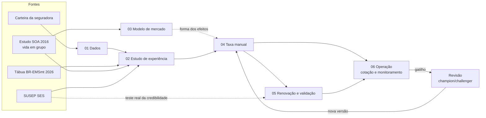

## Notebooks

| Notebook | Pergunta | Principais saídas |
|---|---|---|
| [`01_dados`](notebooks/01_dados.ipynb) | Os dados são confiáveis? Quanto cada grupo esteve exposto? | regras de qualidade com log; exposição; número efetivo de óbitos; tratamento de sexo e nascimento ausentes |
| [`02_estudo_experiencia`](notebooks/02_estudo_experiencia.ipynb) | Onde a mortalidade observada se afasta da esperada? | A/E por variável com IC (SOA, carteira); mercado no SES; A/E por ano-calendário |
| [`03_modelo_mercado_soa`](notebooks/03_modelo_mercado_soa.ipynb) | O que o framework da SOA mostra em dados reais de vida em grupo? | GLM, AGLM, GAM, elastic net, LightGBM comparados; forma dos efeitos usada como priori |
| [`04_taxa_manual`](notebooks/04_taxa_manual.ipynb) | Qual a taxa de um grupo novo? | política para o ano de choque; candidatos no teste fora do tempo; decisão; estabilidade; tabela de fatores |
| [`05_renovacao`](notebooks/05_renovacao.ipynb) | Quanto reajustar na renovação, e com quanta credibilidade? | pooling, IBNR, credibilidade, reajuste; validação no SES e backtest com vários anos-alvo |
| [`06_operacao`](notebooks/06_operacao.ipynb) | Como cotar e acompanhar no dia a dia? | cotação (com histórico do grupo), alertas, monitoramento e gatilhos |
| [`90_validacao_sintetica`](notebooks/90_validacao_sintetica.ipynb) | O código recupera a verdade quando ela é conhecida? | testes de software contra o gerador |

## Metodologia

### 1. Dados (01)

Cada vida contribui com a fração do ano coberta, dentro do ano-apólice do grupo; os esperados somam
$E = \sum q_x t$. Com capitais diferentes, a precisão do A/E em valor é a de um **número efetivo de óbitos**,
$n_{ef} = (\sum C q t)^2 / \sum C^2 q t$. Na subscrição real, é comum faltar o sexo (às vezes o grupo inteiro): o
esperado usa a mistura $p\,q^M + (1-p)\,q^F$ com a proporção de homens do perfil, exata para o número esperado. Na
carteira sintética, a média 50/50 subestimaria os grupos sem sexo em 4,5%; a mistura erra 0,1%.

### 2. Estudo de experiência (02)

A/E univariado com intervalo exato de Poisson. Nos dados reais da SOA, o A/E cai com o capital e com o salário, que
são correlacionados: só um modelo multivariado separa os dois. No SES, a sinistralidade do ramo vida fica perto de 46%
fora da pandemia e vai a 76% em 2021; na carteira, 2021 fica fora do intervalo dos demais anos e não há tendência.

<p float="left">
  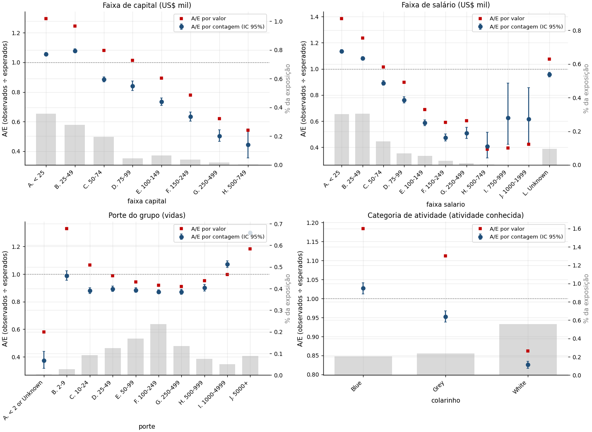
  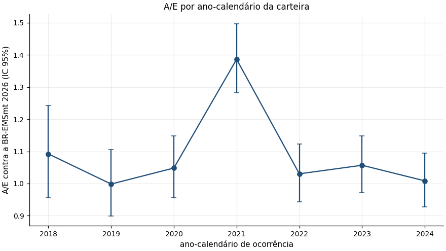
</p>

### 3. Modelo de mercado (03)

O fluxo do framework da SOA (2024) aplicado ao estudo de vida em grupo da SOA: GLM com offset, LightGBM, elastic net
com as interações do LightGBM, AGLM e GAM, comparados num teste reservado. Os modelos multivariados ganham de longe da
tábua; poucos empregadores gigantes dominam a incerteza da comparação (o grupo tem mortalidade própria). Daqui sai a
forma dos efeitos usada como priori na carteira.

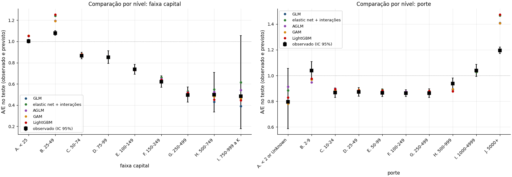

### 4. Taxa manual (04)

Primeiro, a escolha dos dados: excluir o ano de choque (2021) reduz o viés de nível no teste. Depois, candidatos
treinados até 2023 e comparados em 2024, com IC por bootstrap por estipulante, e uma regra de decisão fixada antes:
menor deviance; empates resolvidos pelo mais simples. Na execução atual, AGLM e GLM empatam e fica o **GLM**; plano
atual, GLMM e ridge com priori ficam significativamente atrás. AGLM e GAM confirmam que a forma log-linear do capital
basta. O nível é completado pelo IBNR residual e a estabilidade é medida por bootstrap (CAS 6.4).

<p float="left">
  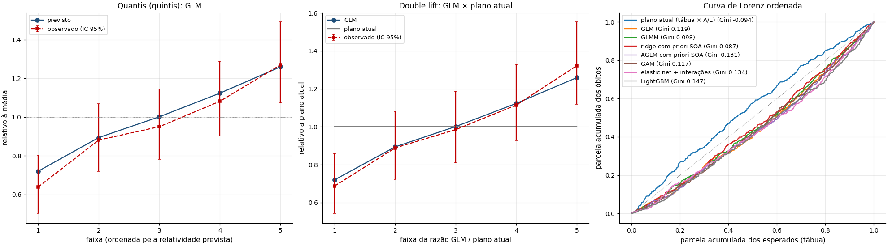
</p>
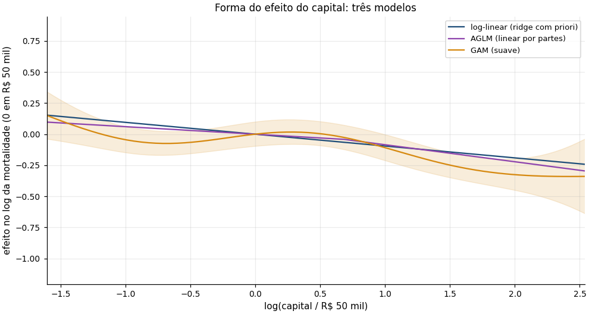

### 5. Renovação e validação (05)

Experiência do grupo contra a taxa manual, em valor limitado ao pooling, com IBNR e sem os anos-apólice do choque:
$\text{fator} = Z\,A/E + (1 - Z)$, $Z = n_{ef}/(n_{ef} + k)$ (Bühlmann-Straub). Validação: com dados reais do SES, a
credibilidade erra cerca de um quarto do que erra a média do mercado; no backtest com quatro anos-alvo, as duas
credibilidades preveem significativamente melhor que só a taxa manual. Sob o prêmio efetivamente cobrado, a
sinistralidade sobe de ~46% para ~61% do menor para o maior risco técnico: o preço praticado não acompanha o risco.

<p float="left">
  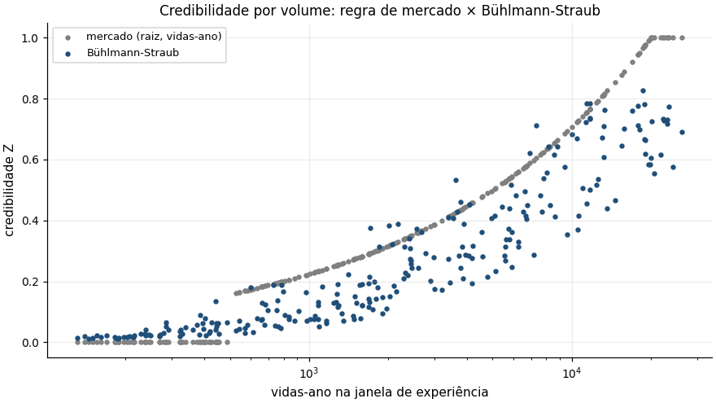
  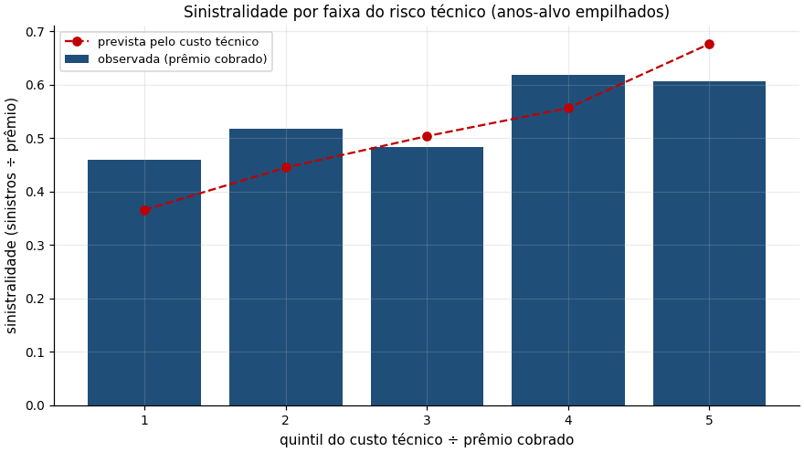
</p>
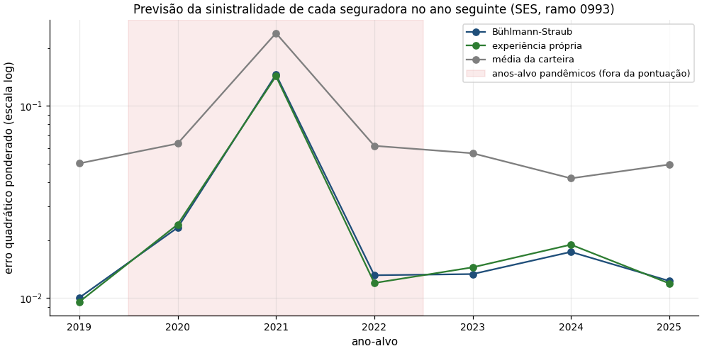

### 6. Operação (06)

Cotação do censo à taxa comercial (pooling, carregamentos, alertas), agora com o **histórico do grupo** que a
subscrição recebe da seguradora anterior, ponderado pela mesma credibilidade da renovação. Monitoramento mensal com
limites exatos de Poisson e funnel plot com a variância entre grupos.

<p float="left">
  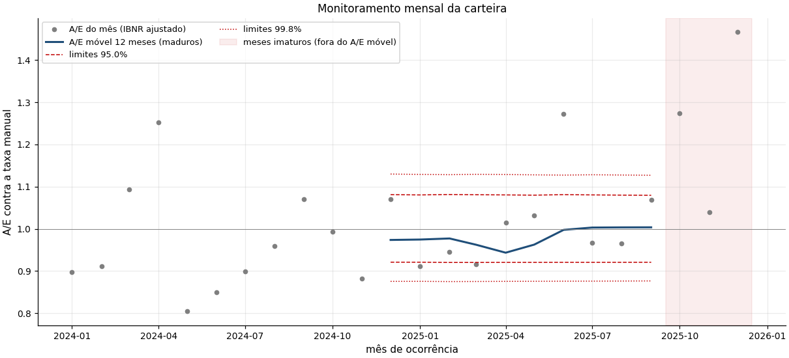
  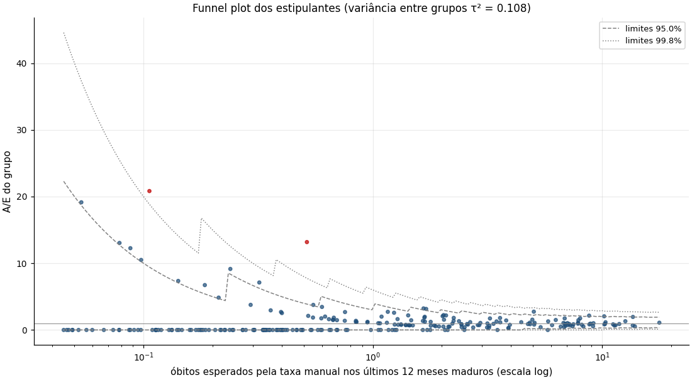
</p>

## Recomendação de modelos para produção

Entre tudo o que foi testado, o que vale levar para a operação, e com que papel. "Teste" = fora do tempo, com IC.

| Papel | Recomendado | Por quê | Os demais |
|---|---|---|---|
| **Taxa manual (tarifa)** | **GLM de Poisson com offset** (log do capital + seção CNAE) | venceu ou empatou com todos os candidatos no teste; tem erro-padrão; cabe na nota técnica e no cotador | **AGLM** fica como desafiante permanente (empatou; entra se ganhar com significância na base real). **Ridge com priori** é a opção para pouca experiência (produto novo, carteira pequena), quando a priori da SOA pesa |
| **Diagnóstico de forma** | **GAM** | mostra se a forma log-linear basta (aqui, a curva do capital tem 2,7 graus de liberdade: quase reta) | não vai para produção |
| **Estrutura faltando** | **LightGBM**, na revisão anual | na SOA, sem os grupos gigantes, foi o único a achar estrutura significativa além do GLM | não vira tarifa: não é explicável fator a fator |
| **Fora da tarifa** | — | GLMM como taxa de grupo novo fica significativamente pior; sua ideia (variância entre grupos) é usada na renovação e no monitoramento | elastic net com interações: referência; bayesiano completo: fora do escopo |
| **Renovação** | **Bühlmann-Straub** + pooling + IBNR (Bornhuetter-Ferguson) | credibilidade significativamente melhor que só a manual; k estimado nos dados; peso pelo número efetivo | a regra de mercado também foi significativamente melhor que só a manual (numericamente até um pouco melhor); a escolha final entre as duas é do champion/challenger na base real |
| **Monitoramento** | Funnel plot com variância entre grupos + gatilhos | limites corretos para vida em grupo | — |
| **Dados faltantes** | Mistura pela proporção de homens; imputação do nascimento com indicador | exato para o esperado; não perde exposição; auditável | excluir registros ou usar 50/50 enviesa quando a ausência se concentra |

## Conformidade com os guias da SOA e da CAS

A modelagem segue o [framework de análise preditiva para estudos de experiência da SOA](https://www.soa.org/resources/research-reports/2024/predictive-analytics-framework/)
(2024) e, na validação, a [monografia nº 5 da CAS](https://www.casact.org/monograph/cas-monograph-no-5) (Goldburd,
Khare, Tevet e Guller, 2ª ed., 2025). O que segue exatamente:

| Elemento | Fonte |
|---|---|
| GLM de Poisson com offset dos esperados da tábua; tabela de coeficientes e ANOVA sequencial (`glm` do R base) | SOA 4.1 |
| LightGBM com perda Poisson; importância por SHAP; tabela de interações (estilo EIX); gráficos SHAP por nível | SOA 4.2 |
| Elastic net (glmnet, LASSO, lambda de menor erro na validação cruzada) com as interações do topo da tabela do LightGBM | SOA 4.3 |
| Treino e teste separados no início; teste usado só no fim; MSE, MAE e deviance no teste | SOA 5; CAS 4.3 |
| Lift por decis, *double lift*, Lorenz/Gini; tabelas de A/M por uma e duas variáveis (±5% e ±10%) | CAS 7.2; SOA 2.4 |
| Candidatos incluem o plano atual; o escolhido é reajustado com todos os dados | CAS 4.3.3 |
| Agrupamento de níveis com pouca experiência | CAS 5.5 |
| Estabilidade dos fatores por bootstrap | CAS 6.4 |
| Gráfico de sinistralidade por faixa de risco previsto | CAS 7.2.3 |

Desvios, só onde a base ou o uso exigem:

| Desvio | Motivo |
|---|---|
| Base da SOA com partição aleatória por célula (a SOA reserva o último ano) | a base de vida em grupo de 2016 não traz o ano de observação; na carteira a partição é fora do tempo, como na SOA |
| GLMM com efeito de estipulante e de divisão CNAE | vida em grupo tem grupos; no 03, poucos empregadores gigantes dominam a incerteza da comparação (CAS 10.1) |
| Ridge com a forma da SOA no offset ("priori") | requisito do projeto; penalização ridge = priori normal (SOA 4.3.1) |
| AGLM e GAM como candidatos adicionais | AGLM (Fujita et al., 2020) mantém a forma de tabela de fatores com não linearidade; GAM diagnostica a forma do capital |
| Validação cruzada e bootstrap por estipulante na carteira | as células de um grupo não são independentes |
| Regra de decisão explícita (menor deviance; empate pela ordem de preferência) | a SOA não prescreve uma regra; é preciso decidir e registrar |
| LightGBM e elastic net com interações só como referência, não como tarifa | tarifa precisa caber numa tabela de fatores e na nota técnica |
| IC exato nas tabelas de A/M | a SOA omite o teste; o IC separa desvio real de ruído |

## Fontes de dados

| Fonte | Real? | Conteúdo | Uso |
|---|---|---|---|
| **BR-EMSmt 2026** (SUSEP) | real, Brasil | q_x por idade e sexo | base do "esperado" em todo o projeto; lida do arquivo oficial e travada por hash |
| **SOA 2016 Group Term Life Mortality Study** | real, EUA (sem ano de observação) | 44,5 milhões de vidas-ano e 96,9 mil óbitos (seguro básico, 2010–2013) por atividade, faixa de capital, salário, porte, sexo e idade | estrutura dos efeitos (capital, salário, atividade, porte); usada só como forma relativa, nunca como nível |
| **SUSEP SES** | real, Brasil | prêmio ganho, sinistro ocorrido e comissão por seguradora, ramo e mês (ramos 0993, 0977, 0982) | nível de sinistralidade do mercado, efeito da pandemia, teste real de credibilidade entre seguradoras |
| **Carteira sintética** | simulada | vidas, capitais, entradas e saídas, sinistros com datas, por estipulante | bancada de teste do pipeline, no formato da base de uma seguradora; calibrada na BR-EMS, no nível do SES e em efeitos plausíveis |

Não existe base pública, no Brasil ou fora, com vidas e sinistros **por estipulante**: esse dado só existe
dentro das seguradoras. Por isso a renovação é demonstrada na carteira sintética, e o mesmo código roda na base
real trocando apenas `config/colunas.yaml`.

A extração da SOA é validada contra o relatório publicado: o A/E por faixa de capital, salário e porte
reproduz as tabelas da SOA com diferença zero (`tests/test_publicos.py`).

## Parâmetros e justificativas

Cada número que muda uma decisão, com o tipo de justificativa. **Política** = definir com a seguradora (nota técnica,
apetite de risco); **fonte** = referência externa; **dados** = medido nos dados; **convenção** = escolha estatística
padrão, sem efeito material dentro de uma faixa razoável.

| Parâmetro | Valor | Tipo | Justificativa |
|---|---|---|---|
| Tábua base | BR-EMSmt 2026 | fonte | versão vigente publicada pela SUSEP (arquivo oficial, hash no config) |
| Maturação da experiência na taxa manual | 12 meses | dados | 97,7% dos sinistros avisados em 12 meses no padrão de aviso da carteira (notebook 05); refazer na base real |
| Janela de experiência na renovação | até 5 anos | fonte | a SOA recomenda estudos a cada 3 a 5 anos: dados recentes e volume suficiente |
| Capital de referência | R$ 50 mil | convenção | só normaliza o fator de capital (vale 1 nesse capital); não muda nenhum preço |
| Mínimo de esperados para uma seção ter fator próprio | 30 óbitos | convenção | com 30 óbitos, o IC de 95% do A/E tem cerca de ±36%; abaixo disso a seção vai para "OUTRAS" |
| Teste dos fatores candidatos | 5% com correção de Holm | convenção | controla falso positivo com vários candidatos; sem Holm, o porte entrou por acaso |
| Credibilidade de mercado | mínimo 500 e plena em 20 mil vidas-ano, regra da raiz | fonte | ordem de grandeza relatada por seguradoras de grupo no [levantamento SOA/Milliman (2013)](https://www.soa.org/files/research/projects/research-2013-iss-in-app-cred.pdf); usada como *champion* a ser batido |
| Nível de pooling | max(R$ 100 mil; 3 × capital médio), limitado à retenção | política | prática de pooling por capital médio e porte do grupo (mesmo levantamento); múltiplo e piso a calibrar com a seguradora |
| Limite de retenção | R$ 2 milhões | política | ilustrativo; vem do contrato de resseguro |
| Carregamento total | 35% | política | ilustrativo; no SES, a comissão sozinha é cerca de 27% do prêmio ganho no ramo 0993 |
| Piso e teto do reajuste | −15% e +40% | política | ilustrativos; limites comerciais da seguradora |
| Regra contratual de referência | 0%, 10% e 15% nas faixas até 75%, 85% e acima; IBNR = 15% do prêmio | fonte | apólice pública de vida em grupo de uma universidade federal; cada contrato tem a sua |
| Mínimo de óbitos por célula nos gráficos de A/E | 30 | convenção | mesmo critério de precisão da linha acima |
| Teste fora do tempo da carteira | treino até 2023, teste 2024 | fonte | partição por ano, como a SOA (5.1) e a CAS (4.3.1) |
| Partição na base da SOA | aleatória, 70/30 | convenção | proporção típica da CAS (4.3.1); a base não tem ano de observação |
| Elastic net | alpha = 1 (LASSO), `lambda.min`, 3 interações do LightGBM | fonte | framework da SOA (4.3 e apêndice A) |
| Ridge com priori | alpha = 0, lambda por validação cruzada por estipulante | fonte | ridge = priori normal (SOA 4.3.1) |
| Regra de decisão | menor deviance no teste; empate se o IC de 95% da diferença (bootstrap por estipulante) contém zero; preferência: ridge com priori, GLMM, GLM, plano atual | convenção | fixada antes do teste; a ridge com priori vem primeiro por combinar experiência própria e evidência externa |
| Anos excluídos da experiência da taxa manual | 2021 | dados | choque externo: A/E de 2021 fora do intervalo dos demais anos; mantê-lo superestima o ano de teste (A/M ~0,91 contra ~0,96); no SES, excluir 2020–2022 do histórico reduz o erro nos anos normais (notebook 05) |
| Anos-alvo do backtest da renovação | 2019, 2022, 2023, 2024 | convenção | anos-apólice que atravessam 2021 ficam fora: nenhum método prevê o choque |
| Carregamentos da cotação | despesas 10%, corretagem 15%, pró-labore 5%, tributos 4,65%, margem 5% | política | ilustrativos; vêm da nota técnica e do tributário |
| Alertas de subscrição | retenção R$ 2 mi; maior vida > 10% ou 10 maiores > 30% do capital; idade > 80; menos de 10 vidas | política | ilustrativos; regras de subscrição da seguradora |
| Limites de controle | 95% (alerta) e 99,8% (ação) | fonte | convenção dos funnel plots (Spiegelhalter, 2005) |
| Meses imaturos no monitoramento | 3 | dados | com 3 meses de idade ~68% dos sinistros estão avisados; antes disso o ajuste de IBNR é instável |
| Gatilho de grupos | mais de 1% acima do limite de 99,8% | convenção | 10 vezes o esperado sob a taxa certa (0,1%), com a variância entre grupos já nos limites |
| AGLM | 9 nós nos quantis do log do capital (variáveis L); faixa etária e porte em variáveis O; LASSO (alpha = 1) | fonte | Fujita et al. (2020); o pacote `aglm` usa bins por quantil e LASSO; aqui a codificação é montada em Python sobre o glmnet (o pacote não pôde ser instalado no ambiente de desenvolvimento; pode substituí-lo) |
| GAM | um termo suave do log do capital, k = 6, suavidade por REML (fREML no `bam`) | convenção | k é o máximo de graus de liberdade; a penalização escolhe quanto usar |
| Sexo ausente | mistura pela proporção de homens (grupo e faixa, grupo, seção e faixa, carteira) | dados | exata para o esperado; a proporção sai da própria base |
| Nascimento ausente | imputado pela idade de entrada mediana do grupo, com indicador | convenção | conserva a exposição; o indicador permite medir o efeito |
| Exclusão na SOA | cobertura desconhecida | dados | 217 óbitos esperados e 2 observados: sinistro não vinculado |

## Como rodar

```bash
pip install -e ".[dev]"
Rscript r/instalar_pacotes.R          # R >= 4.2 com glmmTMB, glmnet, actuar e jsonlite
pytest                                # testes que dependem de R ou de arquivos externos são pulados se faltarem
jupyter lab                           # notebooks na ordem 01 a 06; o 90 é opcional
quarto render report/relatorio.qmd    # depois dos notebooks (lê artefatos/ e resultados/)
```

**Dados públicos (SOA e SES).** Não são versionados. Baixe o zip das tabelas da SOA
([estudo de 2016](https://www.soa.org/resources/experience-studies/2016/2016-group-life-mortality-study/)) e a
base completa do [SES](https://www2.susep.gov.br/menuestatistica/SES/principal.aspx), e rode:

```bash
python scripts/preparar_dados_publicos.py --ses "<pasta BaseCompleta>" --soa "<pasta das tabelas da SOA>" --saida data/publico
python scripts/preparar_dados_publicos.py --agregar-soa --saida data/publico
```

O script filtra o SES nos ramos de pessoas, converte a tabela binária da SOA pelo próprio Excel (Windows) e extrai
os dados de origem das tabelas dinâmicas. Detalhes em `data/publico/README.md`.

**Tábua.** Na primeira execução, o código baixa o arquivo oficial da SUSEP e confere o hash. Detalhes e achados
sobre o arquivo em `data/external/README.md`.

**Por que R.** Um pacote por tarefa: `glm` do R base para GLMs (o motor do framework da SOA), glmmTMB para os
modelos mistos, glmnet para o elastic net e actuar para Bühlmann-Straub. O Python chama o R por `Rscript` (CSV/JSON). Cotar com uma tabela pronta não
exige R; reestimar exige.

## Código

Módulos em `src/vgpricing`, por etapa:

| Etapa | Módulos |
|---|---|
| Dados | `io`, `schema`, `validacao`, `template`, `tabua`, `sintetico`, `publicos` |
| Exposição e experiência | `exposicao`, `estudo`, `ibnr` |
| Modelos | `glmm` (GLM e GLMM), `elasticnet`, `aglm`, `gam`, `prioris`, `diagnostico` (LightGBM) |
| Tarifa | `manual` (base de modelagem, tabelas de fatores, escolha) |
| Validação | `avaliacao` (métricas, lift, Lorenz, A/M, bootstrap), `backtest`, `verdade` (só no 90) |
| Renovação e operação | `renovacao`, `cotador`, `monitoramento` |
| Infraestrutura | `r` (ponte única com o R), `config`, `graficos` |

Scripts R em `r/` (um por pacote: `stats::glm`/`glmmTMB`, `glmnet`, `mgcv`, `actuar`). Configurações em `config/`
(cada número de decisão está ali). Artefatos lidos pela cotação em `artefatos/` (tabela de fatores, priori da SOA,
k da credibilidade); tabelas de decisão em `resultados/`; figuras em `docs/figuras/`. Testes em `tests/`.


## Governança: ciclo de revisão

1. **Monitoramento mensal** (06): A/E da carteira e funnel plot dos grupos. Cada gatilho diz a ação: recalibrar a taxa
   manual, investigar grupos ou cumprir o ciclo anual.
2. **Revisão (champion/challenger):** o pipeline 04 roda com a experiência atualizada e a mudança proposta como
   candidato; o desafiante só substitui o modelo em produção se a regra de decisão de `config/manual.yaml` o escolher
   no teste fora do tempo (o 05 confirma a renovação).
3. **Versionamento:** a nova `artefatos/fatores_manual.yaml` registra modelo, dados, anos excluídos, empates e testes;
   a anterior fica no histórico do git. Cotação e renovação (06 e 05) passam a ler a nova.
4. **Relatório** (`report/relatorio.qmd`) com o checklist ASOP 23, 25 e 56 e LGPD.

## Governança e LGPD

Dados reais e públicos nunca entram no repositório (`.gitignore`). Identificadores entram pseudonimizados
(`vgpricing.io.hash_id`, com sal fora do código). A tábua é travada por hash; a tabela de fatores é versionada com
data, base de dados e fórmula do modelo. Referências de prática: ASOP 23 (dados), ASOP 25 (credibilidade) e
ASOP 56 (modelagem: validação com dados reservados e comparação com modelo alternativo).

## Limitações conhecidas

- **Renovação validada só na carteira sintética:** não há dado público por estipulante. O teste no SES usa
  seguradoras como unidade e sinistralidade com carregamento: é um substituto, não a validação final.
- **SOA é americana:** só a forma relativa dos efeitos é usada, com encolhimento; o mapeamento SIC → CNAE e de
  faixas em dólar para reais é julgamento documentado.
- **Pandemia e tendência:** tratadas no notebook 05. Anos de choque saem da experiência da taxa manual; não há
  tendência fora do choque, então não há fator de tendência (na base real, se houver, o ano-calendário entra no
  modelo). A experiência da renovação exclui os anos-apólice que atravessam o ano de choque.
- **Cobertura:** só morte por qualquer causa. IPA, IFPD e funeral ficam para uma versão seguinte.
