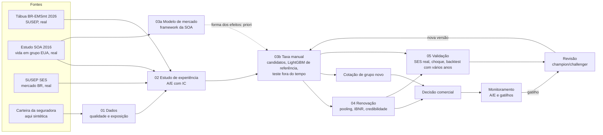

# vida-grupo-pricing

Precificação e renovação de **Vida em Grupo** do jeito que uma área de precificação trabalha: estudo de
experiência, taxa manual sobre a tábua com fatores de risco, renovação com credibilidade, validação fora do
tempo e monitoramento. Métodos maduros, um pacote por tarefa, cada número de decisão justificado.

## Fluxo



## Fontes de dados

| Fonte | Real? | Conteúdo | Uso |
|---|---|---|---|
| **BR-EMSmt 2026** (SUSEP) | real, Brasil | q_x por idade e sexo | base do "esperado" em todo o projeto; lida do arquivo oficial e travada por hash |
| **SOA 2016 Group Term Life Mortality Study** | real, EUA | 44,5 milhões de vidas-ano e 96,9 mil óbitos (seguro básico, 2010–2013) por atividade, faixa de capital, salário, porte, sexo e idade | estrutura dos efeitos (capital, salário, atividade, porte); usada só como forma relativa, nunca como nível |
| **SUSEP SES** | real, Brasil | prêmio ganho, sinistro ocorrido e comissão por seguradora, ramo e mês (ramos 0993, 0977, 0982) | nível de sinistralidade do mercado, efeito da pandemia, teste real de credibilidade entre seguradoras |
| **Carteira sintética** | simulada | vidas, capitais, entradas e saídas, sinistros com datas, por estipulante | bancada de teste do pipeline, no formato da base de uma seguradora; calibrada na BR-EMS, no nível do SES e em efeitos plausíveis |

Não existe base pública, no Brasil ou fora, com vidas e sinistros **por estipulante**: esse dado só existe
dentro das seguradoras. Por isso a renovação é demonstrada na carteira sintética, e o mesmo código roda na base
real trocando apenas `config/colunas.yaml`.

A extração da SOA é validada contra o relatório publicado: o A/E por faixa de capital, salário e porte
reproduz as tabelas da SOA com diferença zero (`tests/test_publicos.py`).

## Etapas

| Notebook | Etapa | Pacote | Situação |
|---|---|---|---|
| `01_dados` | Leitura com mapeamento de colunas, 27 regras de qualidade com log, exposição por ano-apólice, número efetivo de óbitos, conciliação de prêmio | pandas | pronto |
| `02_estudo_experiencia` | A/E por variável com IC exato, A/E cruzado, mercado brasileiro (SES), estudo da carteira | pandas, matplotlib | pronto |
| `03a_modelo_mercado_soa` | Framework da SOA em dados reais de vida em grupo: GLM, LightGBM e elastic net com as interações do LightGBM, comparados no teste (deviance, MSE, MAE, Gini, A/M); forma dos efeitos exportada como priori | stats::glm, glmnet (R), lightgbm | pronto |
| `03b_taxa_manual` | Mesmos passos na carteira, com teste fora do tempo (2024): plano atual, GLM, GLMM, ridge com priori SOA; LightGBM e elastic net como referência; SHAP e teste dirigido no GLMM da interação mais forte do LightGBM; escolha pela regra fixada antes; reajuste com toda a experiência | stats::glm, glmmTMB, glmnet (R), lightgbm | pronto |
| `04_renovacao` | Pooling com encargo, IBNR, credibilidade de Bühlmann-Straub em valor limitado, reajuste com piso e teto, comparação com a regra contratual e com a credibilidade de mercado | chainladder, actuar (R) | pronto |
| `05_validacao` | Credibilidade testada com dados reais (seguradoras no SES); A/E por ano-calendário (choque e tendência); política para o ano de choque; backtest da renovação com vários anos-alvo | actuar (R) | pronto |
| `90_validacao_sintetica` | Teste de software: o código recupera a verdade do gerador | — | pronto |
| — | Monitoramento, governança, cotador e relatório Quarto | — | próximo |

## Como rodar

```bash
pip install -e ".[dev]"
Rscript r/instalar_pacotes.R          # R >= 4.2 com glmmTMB, glmnet, actuar e jsonlite
pytest                                # testes que dependem de R ou de arquivos externos são pulados se faltarem
jupyter lab                           # notebooks na ordem 01, 02, 03a, 03b, 04, 05; o 90 é opcional
```

**Dados públicos (SOA e SES).** Não são versionados. Baixe o zip das tabelas da SOA
([estudo de 2016](https://www.soa.org/resources/experience-studies/2016/2016-group-life-mortality-study/)) e a
base completa do [SES](https://www2.susep.gov.br/menuestatistica/SES/principal.aspx), e rode:

```bash
python scripts/preparar_dados_publicos.py --ses "<pasta BaseCompleta>" --soa "<pasta das tabelas da SOA>" --saida data/publico
python scripts/preparar_dados_publicos.py --agregar-soa --saida data/publico
```

O script filtra o SES nos ramos de pessoas, converte a tabela binária da SOA pelo próprio Excel (Windows) e extrai
os dados de origem das tabelas dinâmicas. Detalhes em `data/publico/README.md`.

**Tábua.** Na primeira execução, o código baixa o arquivo oficial da SUSEP e confere o hash. Detalhes e achados
sobre o arquivo em `data/external/README.md`.

**Por que R.** Um pacote por tarefa: `glm` do R base para GLMs (o motor do framework da SOA), glmmTMB para os
modelos mistos, glmnet para o elastic net e actuar para Bühlmann-Straub. O Python chama o R por `Rscript` (CSV/JSON). Cotar com uma tabela pronta não
exige R; reestimar exige.

## Escolhas de método

### Alinhamento com o framework da SOA e com a monografia da CAS

A modelagem segue o [framework de análise preditiva para estudos de experiência da SOA](https://www.soa.org/resources/research-reports/2024/predictive-analytics-framework/)
(2024) e, na validação, a [monografia nº 5 da CAS](https://www.casact.org/monograph/cas-monograph-no-5) (Goldburd,
Khare, Tevet e Guller, 2ª ed., 2025). O que segue exatamente:

| Elemento | Fonte |
|---|---|
| GLM de Poisson com offset dos esperados da tábua; tabela de coeficientes e ANOVA sequencial (`glm` do R base) | SOA 4.1 |
| LightGBM com perda Poisson; importância por SHAP; tabela de interações (estilo EIX); gráficos SHAP por nível | SOA 4.2 |
| Elastic net (glmnet, LASSO, lambda de menor erro na validação cruzada) com as interações do topo da tabela do LightGBM | SOA 4.3 |
| Treino e teste separados no início; teste usado só no fim; MSE, MAE e deviance no teste | SOA 5; CAS 4.3 |
| Lift por decis, *double lift*, Lorenz/Gini; tabelas de A/M por uma e duas variáveis (±5% e ±10%) | CAS 7.2; SOA 2.4 |
| Candidatos incluem o plano atual; o escolhido é reajustado com todos os dados | CAS 4.3.3 |
| Agrupamento de níveis com pouca experiência | CAS 5.5 |

Desvios, só onde a base ou o uso exigem:

| Desvio | Motivo |
|---|---|
| Base da SOA com partição aleatória por célula (a SOA reserva o último ano) | a base de vida em grupo de 2016 não traz o ano de observação; na carteira a partição é fora do tempo, como na SOA |
| GLMM com efeito de estipulante e de divisão CNAE | vida em grupo tem grupos; no 03a, poucos empregadores gigantes dominam a incerteza da comparação (CAS 10.1) |
| Ridge com a forma da SOA no offset ("priori") | requisito do projeto; penalização ridge = priori normal (SOA 4.3.1) |
| Validação cruzada e bootstrap por estipulante na carteira | as células de um grupo não são independentes |
| Regra de decisão explícita (menor deviance; empate pela ordem de preferência) | a SOA não prescreve uma regra; é preciso decidir e registrar |
| LightGBM e elastic net com interações só como referência, não como tarifa | tarifa precisa caber numa tabela de fatores e na nota técnica |
| IC exato nas tabelas de A/M | a SOA omite o teste; o IC separa desvio real de ruído |

### Outras escolhas

- **Bayesiano completo:** a SOA o cita como opção para medir a incerteza dos parâmetros, com custo de complexidade e
  de escolha de prioris. Aqui não entra: a priori de mercado é incorporada pela penalização.
- **Por que modelo misto, e não GLM comum?** Células do mesmo grupo não são independentes; o GLM trata cada uma
  como informação nova e produz intervalos estreitos demais. Credibilidade e modelos mistos são a mesma teoria
  ([CAS Monograph 14](https://www.casact.org/publications-research/publications/flagship-publications/cas-monographs/monograph-no-14)).
- **Atividade:** seção CNAE como fator fixo e divisão como efeito aleatório dentro da seção (Ohlsson, 2008,
  *Scandinavian Actuarial Journal*): cada divisão recebe credibilidade em torno da sua seção.
- **Estimação em contagem, não em valor:** em R$, poucos sinistros de capital alto dominariam os fatores. O valor
  entra pelo fator de capital e, na renovação, com pooling.
- **Estudo de mercado como "priori":** a forma relativa da SOA (elasticidade ao capital e fatores de seção) entra no
  offset, e o desvio da carteira é estimado com ridge, cujo lambda (validação cruzada) faz o papel do k da
  credibilidade. Na SOA, o capital é o capital médio da **faixa**: o capital médio por célula é incoerente com a faixa
  (células da faixa de US$ 50–74 mil com média de US$ 546 mil), e esse erro de medida atenuava a elasticidade de
  −0,10 para −0,04.
- **A/E da renovação contra a manual, não contra a tábua:** a credibilidade mistura experiência e manual.
- **Ajuste singular:** quando a variância de um efeito aleatório sai zero numérico (abaixo de $10^{-8}$), o efeito é
  retirado e o modelo reajustado, com o registro na tabela de fatores. É o tratamento padrão e torna o resultado
  igual entre versões do glmmTMB (versões recentes devolvem log-verossimilhança `NA` nesses casos). Na carteira
  sintética, o efeito de divisão é retirado assim: com este volume, as divisões não se distinguem das seções.
- **Grupo novo:** com efeito Normal na escala log, o fator esperado de um grupo desconhecido é $e^{\sigma^2/2}$, não 1;
  a tabela de fatores já inclui essa correção.

## Parâmetros e justificativas

Cada número que muda uma decisão, com o tipo de justificativa. **Política** = definir com a seguradora (nota técnica,
apetite de risco); **fonte** = referência externa; **dados** = medido nos dados; **convenção** = escolha estatística
padrão, sem efeito material dentro de uma faixa razoável.

| Parâmetro | Valor | Tipo | Justificativa |
|---|---|---|---|
| Tábua base | BR-EMSmt 2026 | fonte | versão vigente publicada pela SUSEP (arquivo oficial, hash no config) |
| Maturação da experiência na taxa manual | 12 meses | dados | 97,7% dos sinistros avisados em 12 meses no padrão de aviso da carteira (notebook 04); refazer na base real |
| Janela de experiência na renovação | até 5 anos | fonte | a SOA recomenda estudos a cada 3 a 5 anos: dados recentes e volume suficiente |
| Capital de referência | R$ 50 mil | convenção | só normaliza o fator de capital (vale 1 nesse capital); não muda nenhum preço |
| Mínimo de esperados para uma seção ter fator próprio | 30 óbitos | convenção | com 30 óbitos, o IC de 95% do A/E tem cerca de ±36%; abaixo disso a seção vai para "OUTRAS" |
| Teste dos fatores candidatos | 5% com correção de Holm | convenção | controla falso positivo com vários candidatos; sem Holm, o porte entrou por acaso |
| Credibilidade de mercado | mínimo 500 e plena em 20 mil vidas-ano, regra da raiz | fonte | ordem de grandeza relatada por seguradoras de grupo no [levantamento SOA/Milliman (2013)](https://www.soa.org/files/research/projects/research-2013-iss-in-app-cred.pdf); usada como *champion* a ser batido |
| Nível de pooling | max(R$ 100 mil; 3 × capital médio), limitado à retenção | política | prática de pooling por capital médio e porte do grupo (mesmo levantamento); múltiplo e piso a calibrar com a seguradora |
| Limite de retenção | R$ 2 milhões | política | ilustrativo; vem do contrato de resseguro |
| Carregamento total | 35% | política | ilustrativo; no SES, a comissão sozinha é cerca de 27% do prêmio ganho no ramo 0993 |
| Piso e teto do reajuste | −15% e +40% | política | ilustrativos; limites comerciais da seguradora |
| Regra contratual de referência | 0%, 10% e 15% nas faixas até 75%, 85% e acima; IBNR = 15% do prêmio | fonte | apólice pública de vida em grupo de uma universidade federal; cada contrato tem a sua |
| Mínimo de óbitos por célula nos gráficos de A/E | 30 | convenção | mesmo critério de precisão da linha acima |
| Teste fora do tempo da carteira | treino até 2023, teste 2024 | fonte | partição por ano, como a SOA (5.1) e a CAS (4.3.1) |
| Partição na base da SOA | aleatória, 70/30 | convenção | proporção típica da CAS (4.3.1); a base não tem ano de observação |
| Elastic net | alpha = 1 (LASSO), `lambda.min`, 3 interações do LightGBM | fonte | framework da SOA (4.3 e apêndice A) |
| Ridge com priori | alpha = 0, lambda por validação cruzada por estipulante | fonte | ridge = priori normal (SOA 4.3.1) |
| Regra de decisão | menor deviance no teste; empate se o IC de 95% da diferença (bootstrap por estipulante) contém zero; preferência: ridge com priori, GLMM, GLM, plano atual | convenção | fixada antes do teste; a ridge com priori vem primeiro por combinar experiência própria e evidência externa |
| Anos excluídos da experiência da taxa manual | 2021 | dados | choque externo: A/E de 2021 fora do intervalo dos demais anos; mantê-lo superestima o ano de teste (A/M ~0,89 contra ~0,95); no SES, excluir 2020–2022 do histórico reduz o erro nos anos normais (notebook 05) |
| Anos-alvo do backtest da renovação | 2019, 2022, 2023, 2024 | convenção | anos-apólice que atravessam 2021 ficam fora: nenhum método prevê o choque |
| Exclusão na SOA | cobertura desconhecida | dados | 217 óbitos esperados e 2 observados: sinistro não vinculado |

## Limitações conhecidas

- **Renovação validada só na carteira sintética:** não há dado público por estipulante. O teste no SES usa
  seguradoras como unidade e sinistralidade com carregamento: é um substituto, não a validação final.
- **SOA é americana:** só a forma relativa dos efeitos é usada, com encolhimento; o mapeamento SIC → CNAE e de
  faixas em dólar para reais é julgamento documentado.
- **Pandemia e tendência:** tratadas no notebook 05. Anos de choque saem da experiência da taxa manual; não há
  tendência fora do choque, então não há fator de tendência (na base real, se houver, o ano-calendário entra no
  modelo). A experiência da renovação ainda inclui o ano de choque.
- **Cobertura:** só morte por qualquer causa. IPA, IFPD e funeral ficam para uma versão seguinte.

## Estrutura

```
config/      parâmetros versionados (cada número de decisão está aqui)
src/vgpricing/  tabua, io, validacao, exposicao, sintetico, template, publicos, estudo, glmm, elasticnet, prioris,
             avaliacao, graficos, manual, diagnostico, ibnr, renovacao, backtest, verdade
r/           GLM e GLMM (stats::glm e glmmTMB), elastic net (glmnet), Bühlmann-Straub (actuar), instalação
scripts/     preparação dos dados públicos (roda na máquina do usuário)
notebooks/   01, 02, 03a, 03b, 04 e 05 seguem o fluxo; 90 valida o código contra a verdade do gerador
artefatos/   tabela de fatores da taxa manual (lida pelo cotador) e forma da SOA usada como priori
tests/       pytest: casos calculados à mão, reprodução das tabelas da SOA, detecção da sujeira injetada
templates/   Excel de entrada
data/        external/ (tábua), publico/ (SOA e SES), raw/ (dados reais), processed/, synthetic/; tudo fora do git
```

## Governança e LGPD

Dados reais e públicos nunca entram no repositório (`.gitignore`). Identificadores entram pseudonimizados
(`vgpricing.io.hash_id`, com sal fora do código). A tábua é travada por hash; a tabela de fatores é versionada com
data, base de dados e fórmula do modelo. Referências de prática: ASOP 23 (dados), ASOP 25 (credibilidade) e
ASOP 56 (modelagem: validação com dados reservados e comparação com modelo alternativo).
